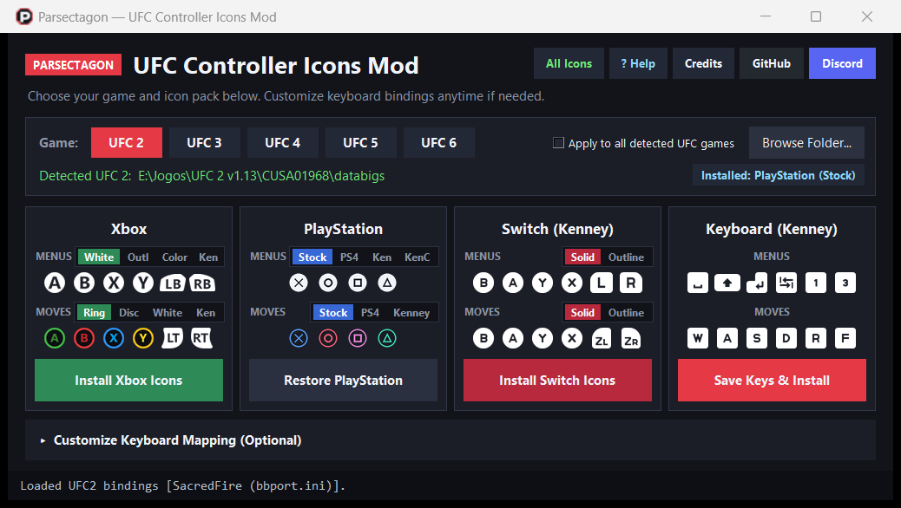
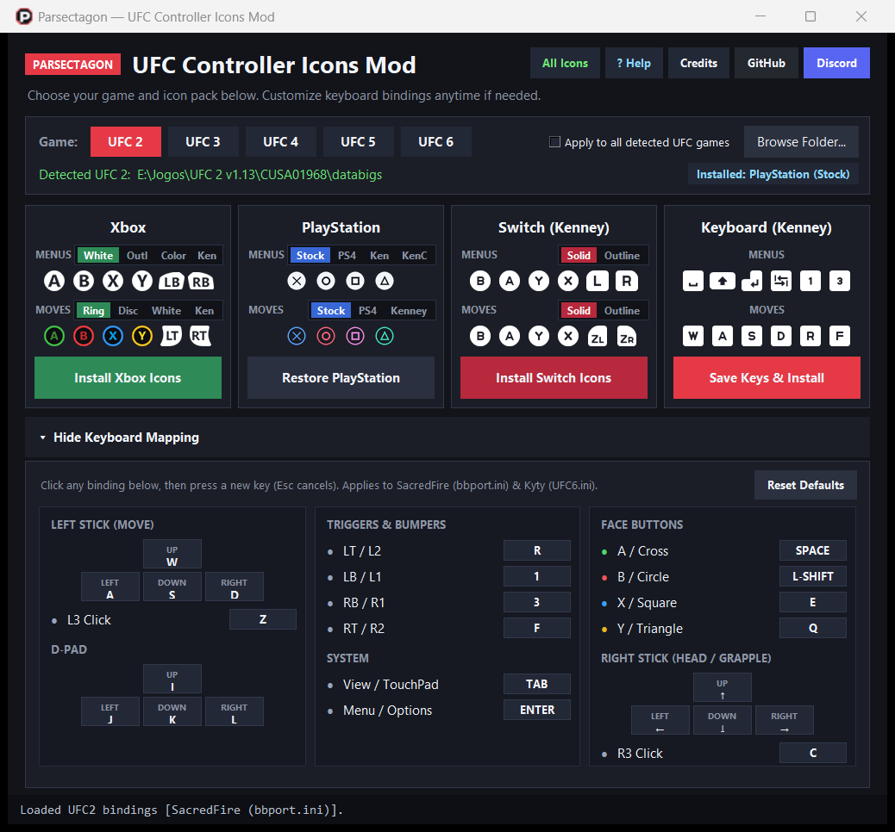
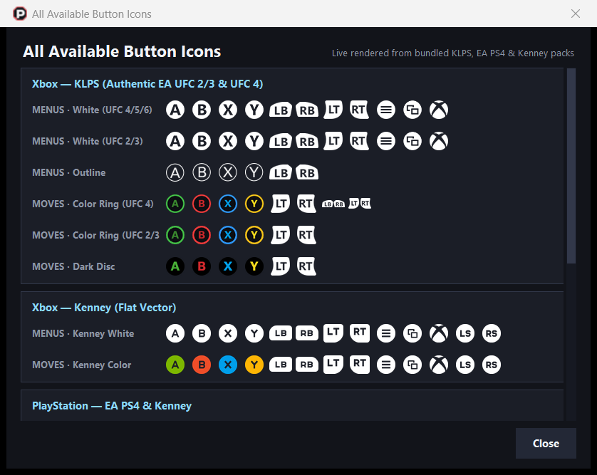
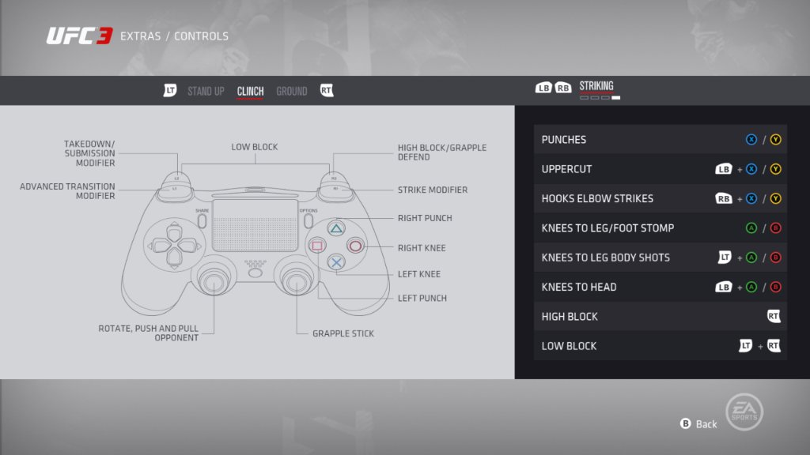
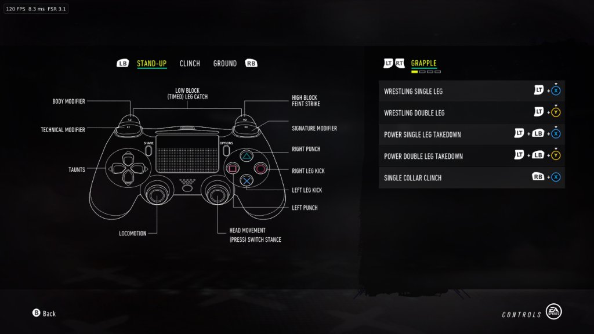

# Parsectagon — UFC Controller Icons Mod

[](https://discord.gg/a84pBw2Ff)
[](https://github.com/thyaguster/ufc-controller-icons-mod/releases/latest)
[](#supported-games)
[](LICENSE)

A standalone, 100% reversible controller & keyboard button prompt installer for **EA Sports UFC 2, UFC 3, UFC 4, UFC 5, and UFC 6** on PC emulation (**SacredFire** & **Kyty**).

---

## Quick Installation

1. **Download** [`UFC_Controller_Icons_Mod.exe`](https://github.com/thyaguster/ufc-controller-icons-mod/releases/latest) from the Releases page (no Python or extra tools required).
2. **Close** any running UFC game or emulator.
3. **Run `UFC_Controller_Icons_Mod.exe`** and pick your game (`UFC 2`, `UFC 3`, `UFC 4`, `UFC 5`, or `UFC 6` — or click **Browse Folder...** to select a custom install path).
   - *Tip:* Check **Apply to all detected UFC games** to patch all of your installed UFC games in one click.
4. **Choose your `MENUS` and `MOVES` presets** on the **Xbox**, **PlayStation**, **Switch (Kenney)**, or **Keyboard (Kenney)** card and preview them live.
   - For **Keyboard**, expand **Customize Keyboard Mapping (Optional)** to rebind any key — bindings save automatically to `bbport.ini` (SacredFire) and `UFC6.ini` (Kyty).
5. **Click Install** and launch the game!
   - **To revert anytime:** Select **PlayStation** (`Stock` / `Stock`) and click **Restore PlayStation** — your verified original files are restored 100% bit-for-bit.

---

## Screenshots

### Main Window & Live Preview


### Keyboard Mapping Drawer (SacredFire & Kyty)


### All Bundled Icon Sets (`All Icons` Gallery)


### In-Game Examples (UFC 3 & UFC 4 — KLPS Xbox Icons)
| UFC 3 | UFC 4 |
| :---: | :---: |
|  |  |

---

## Supported Games

| Game | Title ID | Emulator | Icon Targets Patched |
| :--- | :--- | :--- | :--- |
| **UFC 2** | `CUSA01968` | SacredFire | `inxp_ui_40.big` (`chunkzip` BC7 GNFs, 144 textures) |
| **UFC 3** | `CUSA06534` | SacredFire | `tin.swf` & `samplefedata.swf` + `inxp_ui_40.big` BC7 GNFs |
| **UFC 4** | `CUSA14209` | SacredFire | `buttonart.swf` + `inxp_ui_40.big` BC7 GNFs |
| **UFC 5** | `PPSA03541` | Kyty | Frostbite CAS BC3 textures + Flash UI libraries (`869` verified ranges) |
| **UFC 6** | `PPSA23566` | Kyty | Frostbite CAS BC3 textures + Flash UI libraries (`696` verified ranges) |

## Features

- **Mix-and-Match `MENUS` & `MOVES` Presets:**
  - **Xbox:** Authentic KLPS EA Xbox One icons (`White`, `Outline`, `Color` menus × `Ring`, `Disc`, `White` moves) + **Kenney** flat vector Xbox icons.
  - **PlayStation:** `Stock` (clean restore), `PS4` (authentic colored EA PS4 buttons for UFC 5 & UFC 6), `Kenney White`, and `Kenney Color`.
  - **Nintendo Switch (Kenney):** Physical Switch layout (`B / A / Y / X`, `L / R / ZL / ZR`, `+ / -`, `Home`) in `Solid` or `Outline`.
  - **Keyboard (Kenney):** Crisp double-resolution Kenney keycaps that update live as you remap keys.
- **100% Reversible & Safe:** Automatic verified backups before any write (`%LOCALAPPDATA%\UFCButtonIconsInstaller` for UFC 2/3/4, `.ufc6-input-icons-backup.zip` for UFC 5/6).

## Building from Source

Requires **Python 3.11+**, **Pillow**, and **PyInstaller**:

```powershell
pip install pillow pyinstaller
.\build-standalone-icons-installer.ps1
```

The standalone executable is written to `dist\UFC_Controller_Icons_Mod.exe`.

## Credits & Licenses

- **KLPS** — Authentic EA Sports UFC 2/3 & UFC 4 Xbox One GNF button icon packs.
- **Kenney ([kenney.nl](https://kenney.nl))** — Input Prompts v1.5 (Keyboard & Mouse, Xbox Series, PlayStation Series, Nintendo Switch), licensed under **CC0 1.0 Universal**.
- **Barlow Condensed** — SIL Open Font License.
- **Parsectagon / Portheon / SacredFire / Kyty Community** — [Join the Discord](https://discord.gg/a84pBw2Ff).
- All original game assets remain the property of EA Sports. This tool patches only the user's own local game installation with verified backups.
